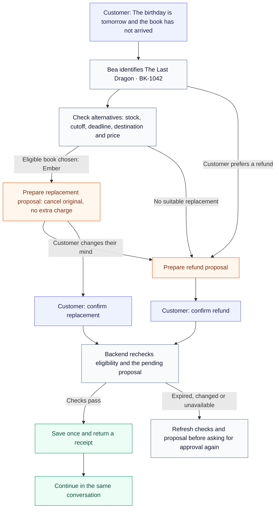

# Bookly Demo

Meet **Bea**, a bookshop support agent that helps customers through chat or voice. One continuous conversation covers order tracking, late gifts, returns and account concerns. Bea checks what is possible and asks for explicit approval before changing an order.

[Architecture and trade-offs](docs/architecture.md)

The customer, books, orders, quotes and policies are synthetic. The app stores persistent demo state in SQLite / Cloudflare D1, but never moves real money or parcels. OpenAI powers live conversation and tool calling; ElevenLabs provides optional speech. Scripted rehearsal is clearly labelled.

## Run locally, step by step

### 1. Install prerequisites

Install **Node.js 24+**, Git and **pnpm 11.25.0**. The tests require Node 24 features.

```bash
node --version
git --version
pnpm --version
```

If pnpm is missing: `npm install --global pnpm@11.25.0`.

### 2. Download the project and dependencies

```bash
git clone https://github.com/rohanrastogi311/Bookly-Demo.git
cd Bookly-Demo
pnpm install --frozen-lockfile
```

### 3. Configure optional provider keys

```bash
cp .env.example .dev.vars
```

Open `.dev.vars` in your editor. For live chat, set `OPENAI_API_KEY` to your own key with API credits. `OPENAI_MODEL` defaults to `gpt-4.1-mini`. For voice, also set `ELEVENLABS_API_KEY`; retain the example voice ID or use one available to your account.

**No keys are included in this repository.** `.dev.vars` and `.env` files are ignored. Keep credentials on the server; never put them in frontend code or commit them. With blank keys, the app runs labelled scripted rehearsal. Voice requires ElevenLabs credentials. A live provider failure shows an error instead of silently changing modes.

### 4. Build and initialise the local database

```bash
pnpm build
node --import ./scripts/sites-env.mjs ./node_modules/wrangler/bin/wrangler.js d1 execute DB --local --config dist/server/wrangler.json --persist-to .wrangler/state --file drizzle/0000_worried_agent_zero.sql
```

Run the database command once per fresh local database. It creates the tables; the app creates synthetic account data when a session starts. This operates locally and needs no Cloudflare account.

### 5. Start the app

```bash
pnpm dev
```

Open the address printed in the terminal, normally **http://localhost:5173**. Restart after changing `.dev.vars`. Text works without a microphone. Voice needs microphone permission and a browser supporting AudioWorklet and WebSocket.

### 6. Run checks

```bash
pnpm test
pnpm typecheck
pnpm build
```

There are **72 automated checks** covering policy, database/HTTP behaviour, voice coordination and confirmation language. Provider responses are mocked in automated tests; these do not measure live response quality.

## Full demo cycle

The simulation clock is **3 November 2026, 10:30 UTC**. Use “tomorrow” even if the real date differs. There is no scenario selector in the customer flow.

### Scenario map

The main journey starts with the late birthday gift. Replacement and refund are alternative outcomes for the same order.



**Approval is specific:** a generic “yes” keeps the proposal pending. A replacement updates stock and cancels the original order; a refund records the refund outcome. Refreshing preserves the receipt, and retrying the same confirmation returns it without repeating the action.

### Continue the conversation

| Customer asks | Bea does |
| --- | --- |
| “Where's my Atlas of Hidden Worlds order?” | Switches to **BK-1051**, shows in-transit tracking and records a review case if the customer wants to change the shipped order. |
| “I want to return The Small Wild Garden.” | Switches to delivered **BK-1038** and checks return policy, offering review rather than an automatic refund. |
| Reports an unfamiliar address or another security concern | Records a simulated security handoff and pauses automated account changes. |

**If the order is unclear, Bea asks a focused question before proceeding.** These are turns in one conversation, with no scenario selector.

<details>
<summary>Step-by-step prompts for running the demo</summary>
1. **Describe the problem:** “My daughter's birthday is tomorrow and her book hasn't arrived.” Bea checks the account and identifies the delayed children's book, **The Last Dragon — BK-1042**. Ambiguous requests prompt clarification.
2. **Find a solution:** “What similar books could arrive in time? She loves dragons.” The backend checks stock, dispatch cutoff, deadline, destination and price. Ember and Dragon School qualify; in-stock books that would arrive too late are excluded.
3. **Review:** Choose Ember. Bea prepares a replacement proposal showing the book, delivery, cancellation of the original and no extra charge. Nothing has been committed yet.
4. **Confirm:** Press **Confirm replacement**, or say/type **“confirm replacement”**. A generic “yes” does not execute a change.
5. **See the outcome:** The backend rechecks eligibility, saves the resolution, reduces stock and returns a receipt. Reloading preserves it. Retrying the same confirmation returns the existing receipt.
6. **Continue naturally:** “Where's my Atlas of Hidden Worlds order?” Bea switches to **BK-1051**, already in transit. Tracking works immediately; changing that shipped order requires a review case.
7. **Try a return:** “I want to return The Small Wild Garden.” **BK-1038** is delivered, so Bea offers policy review rather than inventing an automatic refund.


</details>

Open **Behind the scenes** to inspect actual tool calls and results. Voice and typing share the same session. Voice submits after a short pause; the microphone ignores Bea's playback, then resumes. **Interrupt Bea** stops playback.

## Other scenarios and edge cases

| Situation | Behaviour |
| --- | --- |
| Gift needed today, or shipping cutoff passed | Rejects options that miss the deadline; offers an eligible refund or review. |
| Book unavailable, too expensive or undeliverable | Excludes it from eligible replacements; no unexpected extra charge. |
| Several orders could match | Asks a focused clarification; exact owned titles resolve to canonical order IDs. |
| Customer changes from replacement to refund | Invalidates the previous proposal and prepares a separate refund review. |
| Customer says “yes” or asks how to confirm | Keeps the pending proposal visible without executing it. |
| Quote expires, stock changes or another request updates the session | Rejects stale consent/eligibility and requires fresh checks. Proposals expire after five minutes. |
| Customer confirms twice or refreshes | Same token returns the existing receipt; database constraints prevent duplicate resolutions. |
| Order shipped or delivered | Applies its policy and records a simulated review case when needed. |
| Unfamiliar address / security concern | Records a security handoff and pauses automated account changes. Ordinary order reviews do not block unrelated orders. |
| Consent from another session or cross-origin write | Rejects the request. Sessions use an HttpOnly, SameSite cookie. |
| Provider fails or tool budget is reached | Shows an error or stops the bounded loop; never silently fabricates success or switches to rehearsal. |
| Empty/duplicate speech, interruption or mute | Avoids duplicate turns; mute cancels queued speech and releases resources. Hiding the tab ends microphone access. |

## Reset for recording

Open **Behind the scenes → Reset demo account**. This starts a fresh isolated account with the original three orders and stock, clears the conversation and creates fresh consent tokens.

**New conversation** clears the conversation while preserving completed resolutions and inventory. Use **Reset demo account** to get the original books back.

## Troubleshooting

- **Database missing / no such table:** complete step 4, then restart. Use the same checkout and `.wrangler/state` path for setup and running.
- **AI key configured but responses fail:** check provider credentials, model access and API credits. Choose labelled rehearsal in Connection details to demo without live AI.
- **Voice unavailable:** check the ElevenLabs key, voice access and microphone permission. Text chat still works.
- **SQLite / module-hook errors:** use Node 24+.
- **Port already in use:** stop the old dev process or open the address actually printed by the new server.

## Security and demo boundaries

This repo contains source and synthetic fixtures, excluding runtime secrets, databases, logs and prior Git history. Hosting configuration declares only the local DB binding and does not inherit the original hosted Site identity.

This is a local / access-controlled prototype with one fictional customer. A standalone public deployment needs production authentication, trusted identity handling, rate limits and abuse controls before attaching paid API credentials. The local preview identity is not production authentication.

Handoffs are simulated records, not messages to real staff. Delivery uses one supported B1 destination, a UTC cutoff and no holiday calendar. See [architecture notes](docs/architecture.md) for the six tools, atomic writes and production integration work.
